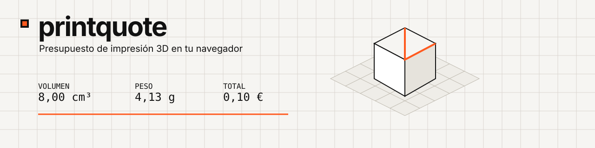
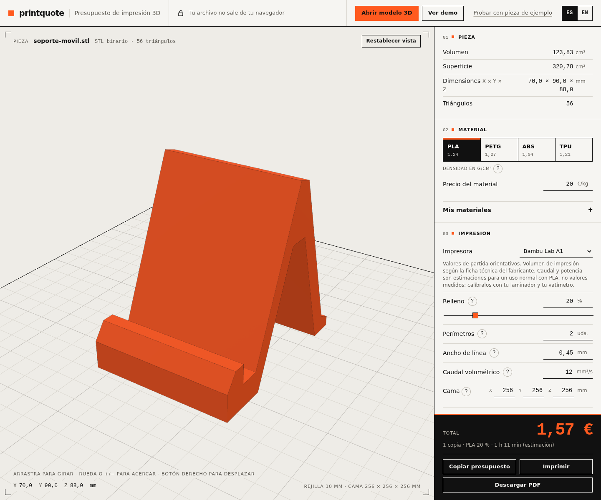
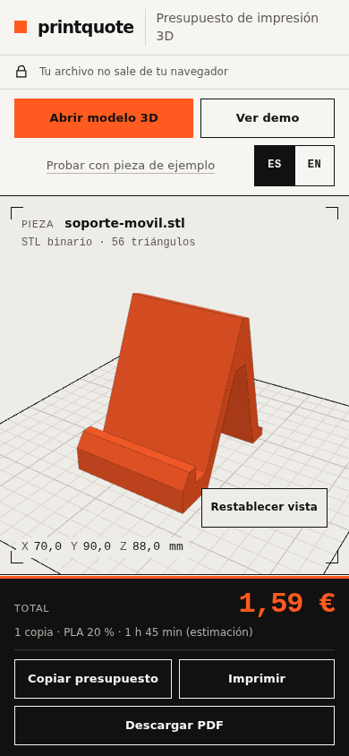
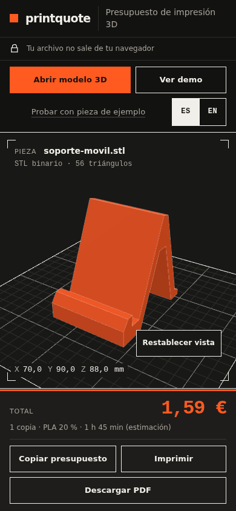

# printquote

    

### [👉 Abrir printquote](https://bertmarti.github.io/printquote/)

[Abrir con la pieza de ejemplo](https://bertmarti.github.io/printquote/#ejemplo)

## Qué es

printquote calcula un presupuesto aproximado para imprimir una pieza 3D: peso, tiempo estimado, material, electricidad y precio final. Está pensado tanto para quien vende impresiones como para quien quiere saber cuánto le costará imprimir en casa. No necesitas instalar nada ni crear una cuenta.

  
  

## Cómo se usa

1. Arrastra un modelo STL, OBJ o 3MF a la ventana, ábrelo desde tu dispositivo o pulsa **«Probar con pieza de ejemplo»** (en la primera visita verás tres pasos de ayuda).
2. Mira la pieza en 3D, sus medidas y los avisos que puedan afectar al cálculo.
3. Elige el material y, si quieres, un perfil de impresora.
4. Ajusta relleno, perímetros, caudal, copias, electricidad y margen. ¿No sabes qué poner? Pulsa el botón **?** junto a cada ajuste: explica qué es y qué valor suele usarse.
5. Revisa el peso, el tiempo estimado y el total.
6. Copia, imprime o descarga el presupuesto en PDF, guárdalo, o comparte los parámetros con un enlace.

## Qué puedes hacer

- 📦 Cargar modelos STL, OBJ y 3MF.
- 🔭 Ver y medir la pieza en un visor 3D con ratón, pantalla táctil o teclado.
- Elegir perfiles de impresora con valores de partida orientativos.
- Guardar **tus impresoras y tus materiales** con nombre («Mis impresoras», «Mis materiales») y aplicarlos con un clic.
- Exportar tus ajustes a un archivo y llevarlos a otro navegador u ordenador («09 Tus datos»).
- Presupuestar un lote de varias piezas y modificar sus copias.
- Descargar un PDF para tu cliente con los datos del negocio, el nombre del cliente, tus condiciones y el IVA.
- Guardar presupuestos, reabrirlos y exportar el historial a CSV.
- Compartir la configuración con un enlace, sin compartir el modelo.
- Usar la interfaz en español o inglés.
- Instalar la app y usarla sin conexión después de la primera visita.
- Activar automáticamente el modo claro u oscuro del sistema.

## Tu archivo no sale de tu navegador

El archivo 3D se lee y se procesa en tu propio dispositivo: no se sube a ningún servidor y no hay cuentas, cookies ni analítica. Los ajustes, tus perfiles, los datos del negocio, el lote y el historial se guardan **solo en este navegador**. Para quitarlo todo de golpe, abre **«09 Tus datos»** y pulsa **«Borrar mis datos»** (dos veces, para confirmar). Los límites son 300 MB por archivo y 6,3 millones de triángulos por pieza, para que la pestaña no se bloquee.

## Presupuestar para tus clientes

1. Abre **«07 Datos del negocio»** y rellena nombre, NIF, contacto y, si quieres, el logotipo y unas **notas para el cliente** (plazo de entrega, forma de pago…).
2. Carga la pieza y ajusta material, relleno y copias.
3. Escribe el nombre del cliente en **«08 Presupuestos»** (opcional).
4. Pulsa **«Descargar PDF»**. Tu cliente verá peso, tiempo estimado, precio por copia, IVA y total; **no** verá tus costes ni tu margen, salvo que marques «Mostrar el desglose de costes en el PDF».

## Cómo calcula (en sencillo)

El peso se estima con el volumen impreso y la densidad del material. El tiempo estimado combina el volumen, el caudal y unos minutos de preparación. El precio suma material y electricidad, y añade el margen que elijas. Es una aproximación útil para presupuestar, no sustituye al laminador: el tiempo es siempre una **estimación**.

Encontrarás el detalle, el ejemplo completo y las limitaciones en [Cómo se calcula](docs/USO.md#11-cómo-se-calcula-con-un-ejemplo-completo).

## Preguntas frecuentes

### ¿Se sube mi archivo?

No. Se procesa en tu navegador y nunca sale de tu dispositivo.

### ¿Qué formatos admite?

STL binario o ASCII, OBJ y 3MF.

### ¿Por qué el tiempo no coincide con mi laminador?

Porque printquote usa una estimación simplificada. El laminador simula movimientos, retracciones, soportes y otros detalles; puedes calibrar el caudal para acercar ambos resultados.

### ¿Por qué la pieza sale diminuta?

STL y OBJ no guardan unidades, y printquote asume milímetros. Revisa la exportación y las dimensiones; el 3MF sí guarda sus unidades.

### ¿Funciona sin conexión y en el móvil?

Sí. Tras abrirla una vez con conexión puedes instalarla y usarla sin red. También funciona en el navegador de un móvil o tableta.

### ¿Cómo paso mis ajustes a otro navegador?

En **«09 Tus datos»** pulsa «Exportar ajustes»: se descarga un archivo `.json` con tus ajustes, perfiles y datos del negocio. En el otro navegador, «Importar ajustes» y elige ese archivo. Los presupuestos guardados se exportan aparte, en CSV, desde «08 Presupuestos».

### Me sale «Datos guardados descartados». ¿Qué ha pasado?

Algo de lo que printquote guardó en este navegador no se podía leer (por ejemplo, porque se modificó a mano o se dañó). La app lo ignora, arranca con los valores por defecto para esa parte y te avisa. Si tenías una copia exportada, impórtala.

### ¿Es gratis?

Sí, es software libre con licencia MIT y no requiere cuenta.

### ¿Dónde aviso de un fallo?

Abre una [incidencia en GitHub](https://github.com/BertMarti/printquote/issues).

## Guía completa

Consulta la [guía de uso](docs/USO.md) para conocer todos los controles, avisos, perfiles, lotes, PDF, historial, privacidad, instalación y calibración.

¿Quieres colaborar o ver cómo está hecho? Lee [docs/DESARROLLO.md](docs/DESARROLLO.md) y [CONTRIBUTING.md](CONTRIBUTING.md).

[Licencia MIT](LICENSE), BertMarti.
